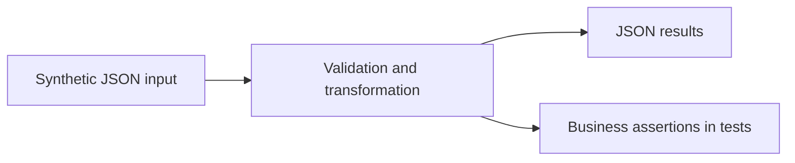

# Sensitive Data Tokenizer

An independent portfolio demonstration prepared for Jahanzeb Akhund, based on the subject areas in his resume. Uses synthetic data. This is newly created sample work, not employer source code or evidence of a historical production deployment.

## What it demonstrates

Governance demonstrations: field allowlists, keyed pseudonyms, and removal of direct identifiers.

## Run locally

Python 3.9 or later; no third-party dependencies, cloud accounts, or credentials required.

```sh
python3 main.py
python3 main.py --input sample.json --output output.json
python3 -m unittest discover -s tests -v
```

`sample-output.json` contains a locally verified example result. `sample.json` is the input contract and reproducible example. `main.py` contains the transformation and a CLI. Output is JSON to stdout or the requested file. Malformed structures may raise Python exceptions; documented business checks reject invalid values.

## Data flow



## Scope and tradeoffs

Uses synthetic records and a clearly marked default demonstration key. This is not HIPAA/GDPR certification or anonymization; production requires secret management and a privacy review.

The demo processes a bounded input locally. It does not claim cloud-scale throughput, production availability, security certification, or the performance improvements listed in a resume. For production adaptation, define source contracts, persistence, secrets, deployment, observability, and operational failure handling for the chosen platform.

## Validation

The included tests check concrete expected business results and input preservation. The optional GitHub Actions template at `docs/verify.yml` runs the tests and CLI on Python 3.9 and 3.12. To enable CI later, install it as `.github/workflows/verify.yml` using GitHub authorization with workflow permission. Local tests run without GitHub access.
